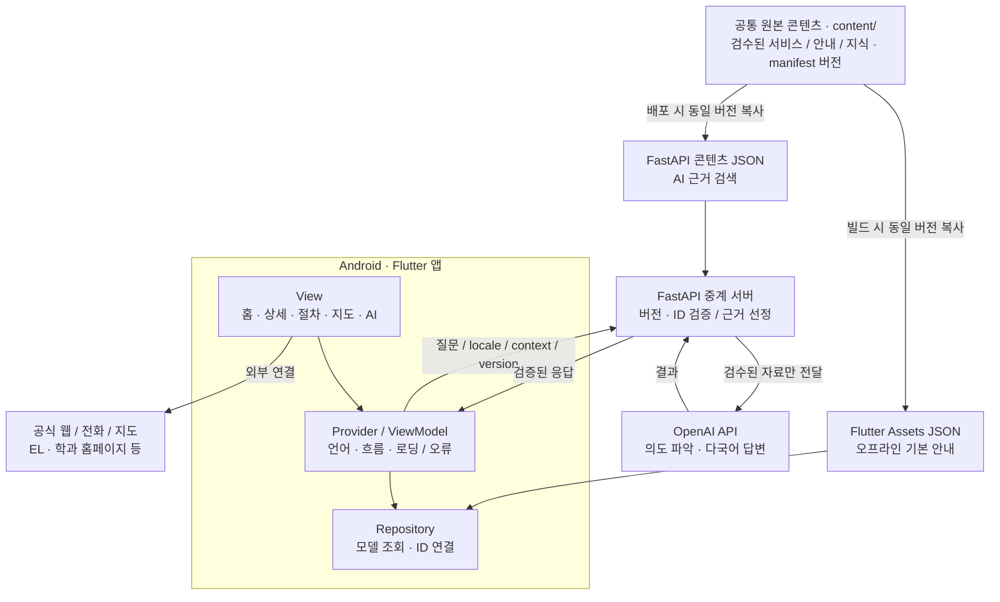
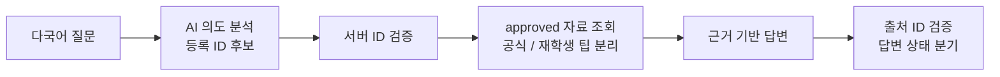

# Cain 개발 기획서 — 최종 v1.1

**시스템 아키텍처 · 화면 흐름 · 공통 데이터 · AI 정책 · API · 3인 개발 계약**

> 이 문서는 최종 v1.1 DOCX의 Markdown 변환본입니다. 구조도는 별도 이미지 없이 볼 수 있도록 Mermaid로 옮겼으며, 예시 JSON과 기술 계약은 원문의 내용을 따릅니다.

| **문서 항목** | **기준**                                                                                    |
|---------------|---------------------------------------------------------------------------------------------|
| 버전          | 최종 설계 v1.1 \| 2026-11-03 \| 이전 v1.0 오류 보완                                         |
| 기획 원본     | [Cain] 외국인 학생을 위한 AI 다국어 캠퍼스 생활 안내 앱 (팀이 제출한 1페이지 최종 기획서) |
| 팀            | 윤우성(팀장·백엔드), 강준형(프론트엔드), 정대윤(PM·기획·프론트엔드)                         |
| 구분 원칙     | 제출 기획서에 포함된 기능 = 확정 범위 / 기술 및 구현 정책 = 제안·개발 합의안                |

# 01 목표 및 개발 범위

교내에 익숙하지 않은 외국인 학생·신입생이 여러 홈페이지를 옮겨 다니지 않고, 자신의 언어로 시설 위치와 준비물·이용 절차를 확인하며 AI에게 후속 질문을 할 수 있는 앱을 제공한다.

| **핵심 영역** | **최종 제출 기획서에 명시된 기능**                              |
|---------------|-----------------------------------------------------------------|
| 다국어        | 첫 실행 언어 선택, 메뉴·이용 절차 다국어 제공, 한국어 명칭 병기 |
| 교내 생활     | 서류 발급 / 전화번호부 / 학생식당 이용 안내                     |
| 지도          | 캠퍼스 건물 위치, 확보된 층별 배치도, 시설·강의실 안내          |
| 학사·온라인   | 학과 홈페이지, 수강신청·강의계획서 확인, EL 사용 방법           |
| AI 챗봇       | 공식 자료와 재학생 경험 팁을 구분하여 질문·상황에 맞는 답변     |

## 구현 전제 (제안)

- Flutter · Android 우선 / Provider(MVVM) / 로컬 JSON / FastAPI 중계 / OpenAI API.

- 첫 통합 시나리오는 재학증명서 발급. 다른 서비스는 공통 상세·단계 화면을 재사용하여 확장한다.

- OCR 사진 번역, 실시간 AR/GPS 안내, 별도 로그인·학교 시스템 직접 연동은 1차 범위 밖이다.

미확정: 최종 지원 언어, 실내 도면 확보 범위, 학교 측 공식 안내 검수 결과, OpenAI 세부 모델.

# 02 화면 정보 구조 · 사용자 흐름

기존 Campus Guide UI 시안의 탐색 → 상세 → 준비 → 단계별 안내 흐름을 재사용한다. AI 챗봇은 홈과 단계 안내 양쪽에서 접근한다.

| **ID** | **화면**                 | **입력 / 동작**                              |
|--------|--------------------------|----------------------------------------------|
| S01    | 언어 선택                | 첫 실행 설정·로컬 저장; 설정에서 변경        |
| S02    | 홈                       | 카테고리·검색·AI 도우미 바로가기             |
| S03    | 서비스 목록 / 검색       | 검색어, 카테고리, 서비스 카드 선택           |
| S04    | 서비스 상세              | 위치·준비물·운영 정보·출처·문의처            |
| S05    | 방문 전 준비 / 단계 안내 | 체크리스트, 현재 단계, 이전/다음, AI 질문    |
| S06    | 캠퍼스 / 건물 지도       | 건물·층 선택, 지도·공간 목록, 정보 상세      |
| S07    | 전화번호부               | 부서·업무 검색, 전화·복사·위치 열기          |
| S08    | 학과·온라인 서비스 안내  | 학과 사이트·수강신청·EL 이용 단계, 공식 링크 |
| S09    | AI 챗봇                  | 선택 언어 질의, 답변·근거·서비스 연결        |
| S10    | 설정                     | 언어 변경, 출처·데이터 버전 정보             |
| S11    | 이용 완료                | 완료된 단계, 후속 확인·다시 보기·홈          |

## 대표 사용자 흐름 (재학증명서)

1. 홈 → 서류발급 목록 → 재학증명서 상세 확인.

2. 준비물·발급 장소 확인 → 단계별 안내 진행.

3. 막힌 단계에서 AI 질문 → 현재 서비스/단계 문맥으로 답변 확인.

4. AI 화면 닫기 → 원래 단계와 체크 상태 유지.

5. 마지막 단계 → 이용 완료 화면 및 공식 문의처 확인.

화면 이동 계약: serviceId, stepId는 경로 인자로 전달. AI 진입 시에는 returnTo(route)와 현재 단계/체크 상태를 ViewModel에서 유지하고, pop 시 복원한다.

# 03 시스템 아키텍처 · 데이터 공급 방식

기본 기능은 로컬 콘텐츠로 동작한다. AI 질문 시에만 FastAPI가 최신 배포된 지식 JSON을 검색하고 OpenAI에 요청한다.



| **구성요소**         | **책임 / 지켜야 할 원칙**                                                  |
|----------------------|----------------------------------------------------------------------------|
| Flutter View         | 화면 표시, 입력 이벤트. JSON·HTTP 호출 로직을 화면에 직접 작성하지 않는다. |
| ViewModel / Provider | 언어, 검색어, 선택 서비스·단계, 로딩/오류/완료 상태 관리.                  |
| Repository           | 공통 모델 파싱·필터·ID 참조 연결; 데이터 공급 방식 변경을 UI에서 숨긴다.   |
| FastAPI              | 버전·요청·ID 검증, 승인된 지식 검색, AI 호출, 근거/오류 후처리.            |
| OpenAI               | 다국어 질문의 의도 파악 및 근거 기반 설명 생성. 정책 사실 생성 금지.       |

동기화 정책: content/가 유일한 원본(Single Source of Truth). 빌드·배포 때 동일한 contentVersion을 앱 Assets와 서버에 반영한다. 실행 중 자동 동기화 기능은 포함하지 않는다.

# 04 공통 JSON 데이터 모델 · ID 관계

화면과 데이터를 분리해 여러 기능에 같은 엔티티를 사용한다. 참조는 제목 문자열이 아니라 안정적인 ID로 처리한다.

| **모델**       | **권장 필드(예시)**                                                                               | **연결**                          |
|----------------|---------------------------------------------------------------------------------------------------|-----------------------------------|
| Service        | id, categoryId, title, summary, buildingId?, contactIds[]                                       | buildingId → Building.id          |
| GuideStep      | id, serviceId, order, title, body, imagePath?, caution?                                           | serviceId → Service.id            |
| Building       | id, name, latitude?, longitude?, imagePath?                                                       | 건물 기준 ID                      |
| FloorMap       | id, buildingId, floor, mapAsset?, rooms[]                                                       | buildingId → Building.id          |
| Room           | id, floorMapId, name, x?, y?, contactId?                                                          | floorMapId → FloorMap.id          |
| Contact        | id, department, duty, phone, buildingId?, officialUrl?                                            | buildingId → Building.id          |
| OnlineGuide    | id, serviceId, officialUrl, steps[]                                                             | serviceId → Service.id            |
| KnowledgeEntry | id, kind, linkedServiceIds[], content, sourceUrl?, sourceLabel?, checkedAt?, verificationStatus | linkedServiceIds[] → Service.id |

## 데이터 무결성 규칙

- Service에는 guideStepIds 목록을 중복 저장하지 않는다. GuideStep.serviceId로 검색하여 order 오름차순 정렬한다.

- Service.contactIds와 Contact.id, FloorMap/Room의 관계를 로딩 시 검사하여 잘못된 참조를 로그로 표시한다.

- name·title·content 등 표시 문구는 {"ko":"...","en":"..."} 형태의 LocalizedText를 사용한다.

- Room.x/y는 도면 너비·높이 기준 0~1 상대 좌표. 좌표가 없으면 도면에 마커 없이 공간 목록으로 표시한다.

- 선택 언어 번역이 없으면 영어(en), 그다음 한국어(ko)를 사용하며, 대체 언어 사용 사실을 표시한다.

- 자료에 없는 위치·수수료·시간은 null/미확인으로 표시하며 사실처럼 채우지 않는다.

## 층별 안내도 예시 · 구조만 제시

```json
{"id":"room_a201", "floorMapId":"floor_a_2", "name":{"ko":"학과 사무실"},
"x":0.42, "y":0.65, "contactId":"contact_dept_a"}
```

# 05 AI 지식 데이터 · 검수 및 출처 정책

제출 기획서의 차별점인 「공식 안내 vs 재학생의 실용 팁」을 데이터와 화면 모두에서 명확하게 구분한다.

| **필드·규칙**           | **정의**                                                                        |
|-------------------------|---------------------------------------------------------------------------------|
| kind                    | official = 공식 자료 기반 정보 / student_tip = 재학생 경험·노하우               |
| verificationStatus      | approved(승인), pending(검토 중), rejected(제외). kind와 독립된 상태.           |
| content                 | 언어별 본문(LocalizedText). text 등 다른 필드명과 혼용 금지.                    |
| sourceUrl / sourceLabel | 공식 정보는 확인 가능한 공식 URL 또는 확인 담당 부서를 명시.                    |
| checkedAt               | 검수·확인한 날짜(YYYY-MM-DD). 공식 정보 approved 시 필수.                       |
| AI 사용 조건            | approved만 검색·프롬프트 투입. pending/rejected는 어떤 답변 근거에서도 제외.    |
| 화면 표시               | 공식 정보와 재학생 팁을 별도 라벨로 표시; 경험담을 학교 규정처럼 서술하지 않음. |

## KnowledgeEntry 예시 · 가상 검수 데이터

```json
{
"id":"kb_cert_approved_01", "kind":"official",
"linkedServiceIds":["certificate_enrollment"],
"content":{"ko":"검수된 공식 발급 안내 문구(예시)"},
"sourceUrl":"https://example.edu/official-guide", "sourceLabel":null,
"checkedAt":"2026-11-03", "verificationStatus":"approved"
}
```

주의: example.edu/official-guide는 구조 설명용 가상 주소이며 실제 한기대 공식 자료가 아니다. 실제 배포 데이터에는 검증된 URL이나 부서 정보를 넣는다.

## 답변 생성 규칙

- 승인된 공식 자료에 있는 사실(장소/운영시간/준비물/수수료)만 확정적으로 안내한다.

- 재학생 팁은 approved 상태라도 “재학생 팁”으로 출처 유형을 분명히 표시한다.

- 근거가 없거나 상충하면 추측하지 않고 insufficient_evidence를 반환하고 문의처를 안내한다.

- AI가 생성한 출처 ID는 서버에서 실제 승인된 근거 목록과 일치하는지 확인한다.

# 06 API 계약 · 요청과 정상 응답

서버의 공용 계약은 /api/v1/chat 하나로 시작한다. 앱 자체 정보 조회는 로컬 JSON에서 처리한다.

| **HTTP** | **경로**     | **역할**                                    |
|----------|--------------|---------------------------------------------|
| GET      | /health      | 서버 생존 확인: {"status":"ok"}             |
| POST     | /api/v1/chat | 다국어 학교생활 질의응답 + 관련 서비스 추천 |

## 앱 → 서버: Request

```http
POST /api/v1/chat
{
"question":"Where can I get an enrollment certificate?",
"locale":"en",
"contentVersion":"2026.11.03.1",
"context":{"serviceId":"certificate_enrollment", "stepId":null}
}
```

## 서버 → 앱: Success Response

```json
{
"status":"answered",
"answer":"See the verified certificate guide in the app.",
"references":[{"id":"kb_cert_approved_01", "kind":"official",
"label":"Verified university guide"}],
"relatedServiceIds":["certificate_enrollment"],
"needsVerification":false,
"contentVersion":"2026.11.03.1"
}
```

## 필드 규칙

- context.serviceId/stepId는 null 허용. stepId가 있으면 해당 serviceId에 속하는지 검증한다.

- status는 answered 또는 insufficient_evidence. 후자는 answer에 확인 안내를 표시하고 needsVerification=true로 둔다.

- references[]에는 서버가 실제로 선택한 approved 문서만 반환한다. AI 텍스트에서 출처 ID를 그대로 신뢰하지 않는다.

- contentVersion이 서버와 호환되지 않으면 409 오류를 반환한다. 호환 버전일 경우 서버는 응답에 사용한 버전을 표시한다.

needsVerification=false는 “근거가 승인된 안내를 사용했다”는 뜻이며, AI 답변 전체를 사람이 사후 검증했다는 뜻은 아니다.

# 07 다국어 AI 처리 · 오류 계약

## 다국어 질문 처리 순서



1. 요청값, 지원 언어, 서비스/단계 ID 및 contentVersion 유효성 검사.

2. AI가 사용자 언어의 의도를 분석하여 “등록된 Service.id” 중 후보 선택(구조화된 응답).

3. 서버가 후보 ID 실존 여부를 검사하고 승인된 official/student_tip 자료만 검색.

4. 근거 본문과 출처 유형을 구분해 AI에 전달하여 선택 언어로 설명 요청.

5. 응답의 출처·서비스 ID를 서버에서 재검사. 부족하면 공식 문의처/기본 안내로 대체.

## 근거 부족 시 응답 (HTTP 200)

```json
{"status":"insufficient_evidence", "answer":"공식 문의처 확인 필요",
"references":[], "relatedServiceIds":[], "needsVerification":true,
"contentVersion":"2026.11.03.1"}
```

## 오류 응답 공통 형식

```json
{"status":"error", "error":{"code":"INVALID_REQUEST",
"message":"Please check your question.", "retryable":false}}
```

| **HTTP**  | **error.code**                    | **앱 처리**                                        |
|-----------|-----------------------------------|----------------------------------------------------|
| 400 / 422 | INVALID_REQUEST / UNKNOWN_CONTEXT | 입력·서비스 연결 확인. 동일 요청 무한 재시도 금지. |
| 409       | CONTENT_VERSION_MISMATCH          | 앱 내부 안내 유지; 데이터/앱 업데이트 필요 메시지. |
| 429       | RATE_LIMITED                      | 질문 잠시 제한·재시도 안내.                        |
| 502 / 503 | AI_UNAVAILABLE                    | 서버·모델 장애; 로컬 안내와 문의처 제공.           |
| 504       | AI_TIMEOUT                        | 시간 초과 안내·재시도 버튼.                        |

보안: OpenAI 키는 서버 환경변수에만 보관한다. 서버는 요청 길이·호출 수 제한을 적용하고 민감한 학번·비밀번호·결제 정보를 요구하지 않는다.

# 08 코드 구조 · 기술 선택안

기능별 폴더를 분리하되 공통 원본 콘텐츠와 모델 계약을 공동 관리한다. 아래 구조는 개발 제안안이다.

```text
cain/
├── content/                        # 공통 원본 JSON + manifest.json
├── scripts/
│   └── sync_content.py             # 앱/서버로 동일 버전 복사·검증
├── app/
│   ├── assets/
│   │   ├── data/                   # 앱에 포함할 데이터 복사본
│   │   └── maps/                   # 캠퍼스 및 층별 배치도
│   └── lib/
│       ├── app/                    # app.dart, routes.dart, theme
│       ├── core/                   # models, repositories, api, locale
│       ├── features/               # home, guides, campus, directory,
│       │                           # online, assistant, settings
│       └── shared/widgets/         # 공통 카드·근거 라벨·단계 버튼
├── server/
│   ├── app/
│   │   ├── main.py                 # FastAPI 진입점
│   │   ├── routes/chat.py          # POST /api/v1/chat
│   │   ├── services/intent.py      # 등록된 서비스 의도 분석
│   │   ├── services/knowledge.py   # approved 근거 조회
│   │   ├── services/ai.py          # OpenAI 호출·응답 후처리
│   │   └── schemas/chat.py         # 요청·응답 계약
│   └── content/                    # 서버 배포용 검수 JSON 복사본
└── docs/                           # 기술 결정·테스트·API 계약
```

| **기술 영역**  | **추천 기술**                    | **사유**                                |
|----------------|----------------------------------|-----------------------------------------|
| Flutter        | Android 우선                     | 수업과 목표 플랫폼 일치                 |
| 상태관리       | Provider + ChangeNotifier        | 공통 언어·진행 상태 전달; 수업 7장 활용 |
| 화면 이동      | Navigator + serviceId / stepId   | 단순한 화면 인자 계약                   |
| 콘텐츠         | 로컬 JSON · 단일 원본            | 기본 화면 오프라인, 서버 DB 초기 제외   |
| 고정 UI 다국어 | flutter_localizations + intl/ARB | 메뉴 번역 체계화                        |
| 서버           | Python FastAPI                   | AI만 중계하는 경량 API                  |
| AI             | OpenAI API                       | 모델/키는 서버에만 관리                 |
| 외부 링크      | url_launcher                     | EL·학과 홈페이지·전화·지도 앱 연결      |

로컬 JSON의 변경은 일반적으로 앱 업데이트 후 반영된다. 서버 JSON만 바꾸어 앱의 기본 화면이 즉시 갱신되는 것은 아니며, 원격 데이터 갱신은 추후 확장으로 둔다.

# 09 역할 분담 · 병렬 개발 계약

최종 제출 기획서의 역할을 유지한다. 구현 경계와 산출물은 개발 단계의 실무 제안으로 정리했다.

| 담당 | 책임 범위 | 검수 가능한 산출물 |
| --- | --- | --- |
| 강준형<br>프론트엔드 | 언어 선택, 홈/검색, 캠퍼스·건물 지도, 화면 이동 및 서버 API 클라이언트 | 공통 UI/라우팅, 지도·건물 화면, AI 연결 UI |
| 윤우성<br>백엔드 | 공통 스키마 최종 관리, 공통 콘텐츠 복사·버전 검증, FastAPI, AI 의도/근거 검색·보안/오류 | JSON 스키마, 콘텐츠 검증 스크립트, API 계약 및 실행 안내 |
| 정대윤<br>PM·기획·프론트 | 안내 자료 수집·검수 기록, 서류/식당/온라인 서비스 상세·단계·완료 화면, 통합 일정 | 서비스 콘텐츠, 공통 안내 UI, 시연·검수 체크리스트 |

## 병렬 개발 전 5가지 계약

1. 모델 계약: Service/GuideStep/Building/FloorMap/Room/Contact/KnowledgeEntry 이름·ID·null 처리 고정.

2. 데이터 계약: content/ 원본과 manifest.contentVersion 사용, 앱/서버 데이터 복사 후 ID 검증.

3. 화면 계약: serviceId + stepId 전달, S09 AI 진입 후 원래 S05 단계·체크 상태 복원.

4. API 계약: /api/v1/chat 성공·부족·오류/버전 불일치 JSON과 UI 문구 확정.

5. 협업 계약: feature/* 브랜치 → PR → 다른 1명이 리뷰; 공통 모델/API 수정은 3인 사전 합의.

## 첫 통합 개발 단위 (Vertical Slice)

재학증명서 서비스 1건을 공통 JSON에 등록 → 목록·상세 → 단계 안내 → AI 질문 → 원래 단계 복귀 → 이용 완료까지 연결. 이 시나리오가 안정화되면 학생식당/온라인 서비스 데이터를 재사용한다.

개인 실기평가 대비: 각자 담당 기능에 더해 UI → ViewModel → Repository → 서버 → AI의 전체 실행 흐름을 팀 전체가 설명할 수 있도록 서로 코드 리뷰한다.

# 10 테스트 기준 · 위험 대응

## 핵심 동작 완료 조건

□ 언어 선택이 저장되어 앱 재시작 후 유지되고, 번역 누락 시 fallback UI가 표시된다.

□ 재학증명서: 홈 → 상세 → 준비 → 단계 → AI 질문 → 단계 복귀 → 완료 화면이 정상 동작한다.

□ 전화번호부에서 업무 검색, 전화/복사와 관련 건물 연결이 작동한다.

□ 학생식당 안내에는 검수된 운영·결제 정보만 확정적으로 표시된다.

□ 캠퍼스 지도에서 건물·층·공간을 확인하고 도면이 없으면 목록으로 대체된다.

□ 학과 홈페이지, EL, 수강신청 안내 화면에서 검증된 공식 링크가 열린다.

□ AI가 영어 질문을 등록 Service.id로 연결하고, 승인된 근거·재학생 팁을 구분한다.

□ pending/rejected 근거는 AI 응답에 등장하지 않고 불확실한 질문은 추측하지 않는다.

□ 버전 불일치(409)·요청 오류(422)·호출 제한(429)·AI 장애/시간 초과(503/504)를 처리한다.

□ Android 실기기에서 긴 다국어 글자, 뒤로가기, 이미지 누락, 오프라인 기본 안내를 확인한다.

## 리스크 및 예방 전략

| **위험**             | **대응**                                                       |
|----------------------|----------------------------------------------------------------|
| 학교 정보 오기재     | 확인된 공식 근거/날짜만 approved. 불확실하면 “확인 필요” 표시. |
| 팁이 규정처럼 표현됨 | official / student_tip 라벨 분리, AI 입력에도 유형 구분.       |
| 다국어 의미 오해     | 등록된 서비스 ID 후보만 선택, 폴백 언어와 한국어 명칭 병기.    |
| 앱·서버 JSON 불일치  | 단일 원본, manifest 버전, 배포 시 스키마/ID 검증, 409 처리.    |
| API 장애·과금        | 기본 안내 독립 동작, 환경변수 키 보관, 제한·타임아웃.          |
| 층별 도면 수집 실패  | 확보한 도면만 표시하고 나머지는 층별 공간 목록 사용.           |

# 11 개발 착수 결정표 · 변경 이력

최종 제출 기획서에는 아래 세부 기술이 직접 명시되어 있지 않으므로, 구현 전에 담당자끼리 승인하면 충분하다.

| **협의 항목** | **기본 제안**                                                  | **결정**      |
|---------------|----------------------------------------------------------------|---------------|
| 초기 언어     | 한국어·영어로 UI 검증 후 추가 언어 수요·품질 테스트            | □ 동의 □ 변경 |
| 실내 안내도   | 도면 이미지 + 0~1 상대 좌표 마커; 미확보 시 목록형             | □ 동의 □ 변경 |
| 온라인 안내   | EL·학과 사이트 등 공식 링크 + 사용 방법; 직접 로그인 연동 제외 | □ 동의 □ 변경 |
| AI 지식 정책  | approved 자료만 사용, official·student_tip 라벨 분리           | □ 동의 □ 변경 |
| 공통 콘텐츠   | content/ 단일 원본, 앱·서버 동일 contentVersion 사용           | □ 동의 □ 변경 |
| 첫 시연       | 재학증명서 발급 + 단계 기반 AI 질문 + 완료                     | □ 동의 □ 변경 |
| 세부 AI 모델  | OpenAI API 유지, 정확도·비용 확인 후 모델 ID 고정              | □ 동의 □ 변경 |

## v1.0 → v1.1 수정 내역

- 데이터 참조 오류 정정, GuideStep 관계 중복 제거, Room 위치 좌표와 화면 폴백 보완.

- KnowledgeEntry content 필드 통일 및 승인/대기/제외 검수 규칙 명시.

- AI 다국어 의도 분석 + 검증된 서비스 ID 선택 + 승인 근거 조회 파이프라인 추가.

- 앱·서버 JSON 단일 원본 및 contentVersion 일관성/409 처리 정책 추가.

- S11 완료 화면, 단계 복귀 상태, API 오류 계약, 검증 체크리스트 추가.

- 문서 내 항목 번호를 새 섹션별 1부터 시작하도록 정리.

## 핵심 설계 결론

Cain은 검수된 학교 안내 콘텐츠를 JSON으로 제공하고, AI 질문 시 서버에서 승인된 공식 자료와 재학생 팁을 조회한 다음 OpenAI가 선택 언어로 설명하도록 구성하는 Flutter Android 앱이다.

## 근거 문서 및 주의

① 2026 모바일프로그래밍 팀프로젝트 제출 최종 기획서 (업로드 1페이지) · ② 2026 모바일프로그래밍 팀프로젝트 가이드

③ Flutter 아키텍처: https://docs.flutter.dev/app-architecture/guide

④ OpenAI API 키 보안: https://help.openai.com/en/articles/5112595-best-practices-for-api-key-safety

주의: 실제 학교의 발급 위치·운영시간·수수료·실내 지도·연락처 등 사실 정보는 이 문서만으로 검증하지 않았다. 실제 자료 확보와 승인 후 데이터에 반영한다.
